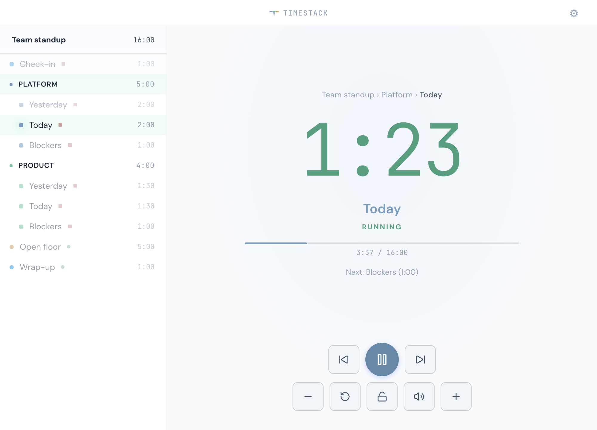
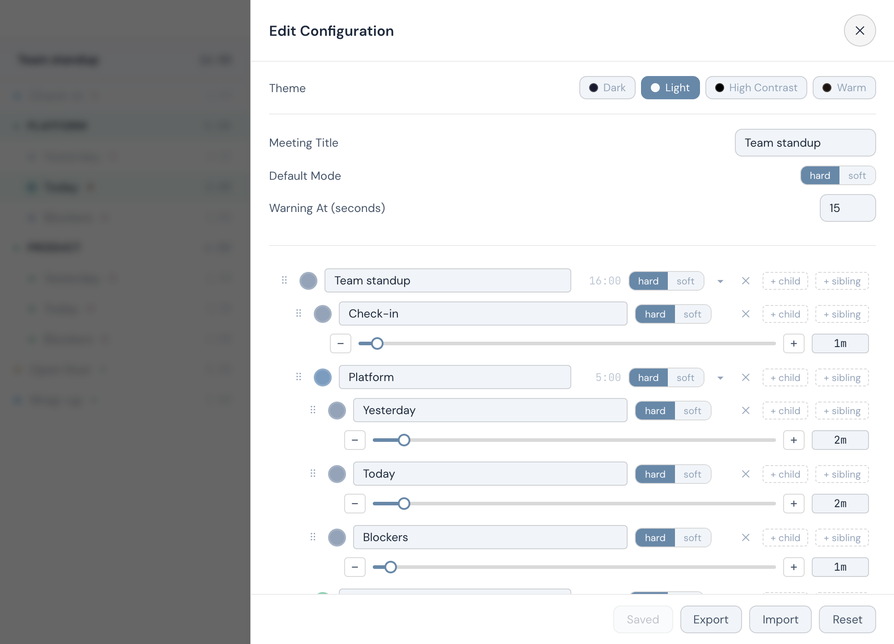

<div align="center">


# Timestack

**Time, in layers.**

A countdown timer that nests: describe your meeting as a tree of timed segments,<br>
and Timestack counts down through each one with visual cues and audio alerts.

[](https://github.com/jackchuka/timestack/releases)
[](LICENSE)
[](package.json)

<picture>
  <source media="(prefers-color-scheme: dark)" srcset="assets/timer-dark.png">
  
</picture>

[Installation](#installation) · [Quick Start](#quick-start) · [Keyboard Shortcuts](#keyboard-shortcuts) · [Config Format](#config-format) · [Development](#development)

</div>

---

A standup or review usually has structure: a check-in, a few minutes per team, and within each team a slot for updates and one for blockers. A flat list of timers loses that structure, and a single timer can't tell anyone when to move on. **Timestack** takes the agenda as a tree, adds up the durations for each branch, and counts down through the leaf segments in order, so everyone can see where the meeting is and how much time is left at every level.

## Features

- **Nested segments** — group segments to any depth (e.g. Platform > Yesterday, Today, Blockers); each group shows its total
- **Hard and soft modes** — hard segments advance to the next one at zero, soft segments keep counting into overtime
- **Inheritance** — mode, color and warning threshold flow from a parent to its children unless overridden
- **Warnings and audio** — the display changes color as time runs low, with beeps for the warning, the end of a segment, and every 30 seconds of overtime
- **Live adjustments** — add or remove 30 seconds, skip, go back, or jump to any segment from the sidebar
- **Lock** — ignore accidental clicks and key presses while presenting
- **Visual editor** — build the tree in the app, with drag-and-drop reordering and JSON import and export
- **Themes** — dark, light, high contrast and warm
- **Local only** — the agenda and theme are stored on your machine; nothing is sent anywhere
- **Desktop app** — built with Tauri for macOS, Windows and Linux

## Installation

### Homebrew (macOS)

```bash
brew install --cask jackchuka/tap/timestack
```

The app is not signed with an Apple Developer ID. If macOS reports that it is damaged and can't be opened, clear the quarantine attribute:

```bash
xattr -cr /Applications/timestack.app
```

### Download

Installers for every platform are attached to the [latest release](https://github.com/jackchuka/timestack/releases/latest):

| Platform | Files                                                  |
| -------- | ------------------------------------------------------ |
| macOS    | `.dmg` for Apple silicon (`aarch64`) and Intel (`x64`) |
| Windows  | `.msi` or `-setup.exe`                                 |
| Linux    | `.AppImage`, `.deb` or `.rpm`                          |

## Quick Start

1. **Open** Timestack. It starts with a sample daily standup agenda.
2. **Edit** the agenda with the gear icon in the top-right corner: rename segments, set durations, add children or siblings, and drag to reorder. Click **Save** to apply; the agenda is kept for next time.
3. **Start** the timer with <kbd>Space</kbd>. Timestack moves through the leaf segments in order; click any segment in the sidebar to jump to it.

To reuse an agenda, use **Export** in the editor to save it as `timestack-config.json`, and **Import** to load one.

<picture>
  <source media="(prefers-color-scheme: dark)" srcset="assets/editor-dark.png">
  
</picture>

## Keyboard Shortcuts

| Key                         | Action                                  |
| --------------------------- | --------------------------------------- |
| <kbd>Space</kbd>            | Play / pause                            |
| <kbd>→</kbd> / <kbd>←</kbd> | Skip to next / back to previous segment |
| <kbd>+</kbd> / <kbd>-</kbd> | Add / remove 30 seconds                 |
| <kbd>R</kbd>                | Reset                                   |
| <kbd>L</kbd>                | Lock / unlock the controls              |
| <kbd>M</kbd>                | Mute / unmute                           |
| <kbd>F</kbd>                | Toggle fullscreen                       |
| <kbd>Esc</kbd>              | Close the editor                        |

While locked, only <kbd>L</kbd>, <kbd>M</kbd> and <kbd>F</kbd> respond.

## Config Format

An agenda is a JSON file with global settings and a tree of segments. Leaf segments have a `duration`; a segment with `children` takes the sum of its children.

```json
{
  "version": 1,
  "title": "Team standup",
  "config": {
    "defaultMode": "hard",
    "warningAt": 15
  },
  "root": {
    "name": "Team standup",
    "children": [
      { "name": "Check-in", "duration": "1m" },
      {
        "name": "Platform",
        "color": "#7c9cbf",
        "children": [
          { "name": "Yesterday", "duration": "2m" },
          { "name": "Today", "duration": "2m" },
          { "name": "Blockers", "duration": "1m" }
        ]
      },
      {
        "name": "Product",
        "color": "#7bc5a3",
        "children": [
          { "name": "Yesterday", "duration": "1m30s" },
          { "name": "Today", "duration": "1m30s" },
          { "name": "Blockers", "duration": "1m" }
        ]
      },
      {
        "name": "Open floor",
        "duration": "5m",
        "mode": "soft",
        "color": "#c9a26b"
      },
      { "name": "Wrap-up", "duration": "1m", "mode": "soft" }
    ]
  }
}
```

### Top level

| Field                | Description                                 | Example          |
| -------------------- | ------------------------------------------- | ---------------- |
| `version`            | Config format version; must be `1`          | `1`              |
| `title`              | Shown on the start screen                   | `"Team standup"` |
| `config.defaultMode` | Mode for segments that don't set one        | `"hard"`         |
| `config.warningAt`   | Seconds before the end of a segment to warn | `10`             |
| `root`               | The top segment of the tree                 |                  |

### Segments

| Field       | Description                                                               | Example                              |
| ----------- | ------------------------------------------------------------------------- | ------------------------------------ |
| `name`      | Segment name (required)                                                   | `"Blockers"`                         |
| `duration`  | Required on leaf segments: minutes and/or seconds; minutes may be decimal | `"3m"`, `"90s"`, `"1m30s"`, `"1.5m"` |
| `children`  | Nested segments; must not be empty when present                           |                                      |
| `mode`      | `"hard"` advances at zero, `"soft"` counts into overtime until you skip   | `"soft"`                             |
| `color`     | Hex color for the segment                                                 | `"#3b82f6"`                          |
| `warningAt` | Per-segment warning threshold in seconds                                  | `30`                                 |

`mode`, `color` and `warningAt` are inherited by children. Without any `color`, segments use `#3498db`.

## Development

Requires [pnpm](https://pnpm.io/) 10+, and the [Rust toolchain](https://v2.tauri.app/start/prerequisites/) for desktop builds.

```bash
pnpm install
pnpm dev          # web app at http://localhost:5173
pnpm tauri:dev    # desktop app in dev mode
```

| Command            | Description                                          |
| ------------------ | ---------------------------------------------------- |
| `pnpm build`       | Type-check and build a single-file `dist/index.html` |
| `pnpm tauri:build` | Build the desktop app and installers                 |
| `pnpm test`        | Run tests (Vitest)                                   |
| `pnpm check`       | Type-check, lint, format check and tests             |
| `pnpm lint`        | Lint with oxlint (`lint:fix` to fix)                 |
| `pnpm fmt`         | Format with oxfmt (`fmt:check` to check only)        |
| `pnpm knip`        | Find unused files, exports and dependencies          |

### Architecture

```
src/
├── main.ts            # App entry, wires everything together
├── timer-engine.ts    # Countdown logic: tick loop and segment state machine
├── config.ts          # Duration parsing, validation, tree resolution and flattening
├── audio.ts           # Web Audio API beeps
├── persistence.ts     # localStorage, JSON import and export
├── theme.ts           # Theme switching
├── types.ts           # Type definitions
└── ui/
    ├── display.ts     # Main timer display
    ├── sidebar.ts     # Segment tree sidebar
    ├── controls.ts    # Playback controls and keyboard shortcuts
    ├── editor.ts      # Config editor
    ├── editor-tree.ts # Tree view for the editor
    ├── dialog.ts      # Modal dialog
    └── icons.ts       # Inline SVG icons
```

- **Zero runtime dependencies** — vanilla TypeScript, Web Audio API and localStorage
- **Single-file build** — `vite-plugin-singlefile` inlines everything into one HTML file, which Tauri wraps as the desktop app
- **Tree in, list out** — the tree is resolved (inheritance, totals) and flattened to its leaf segments for the timer engine
- **State machine** — each segment moves through `pending`, `running`, `warning`, `overtime`, `paused` and `done`

## License

[MIT](LICENSE)
